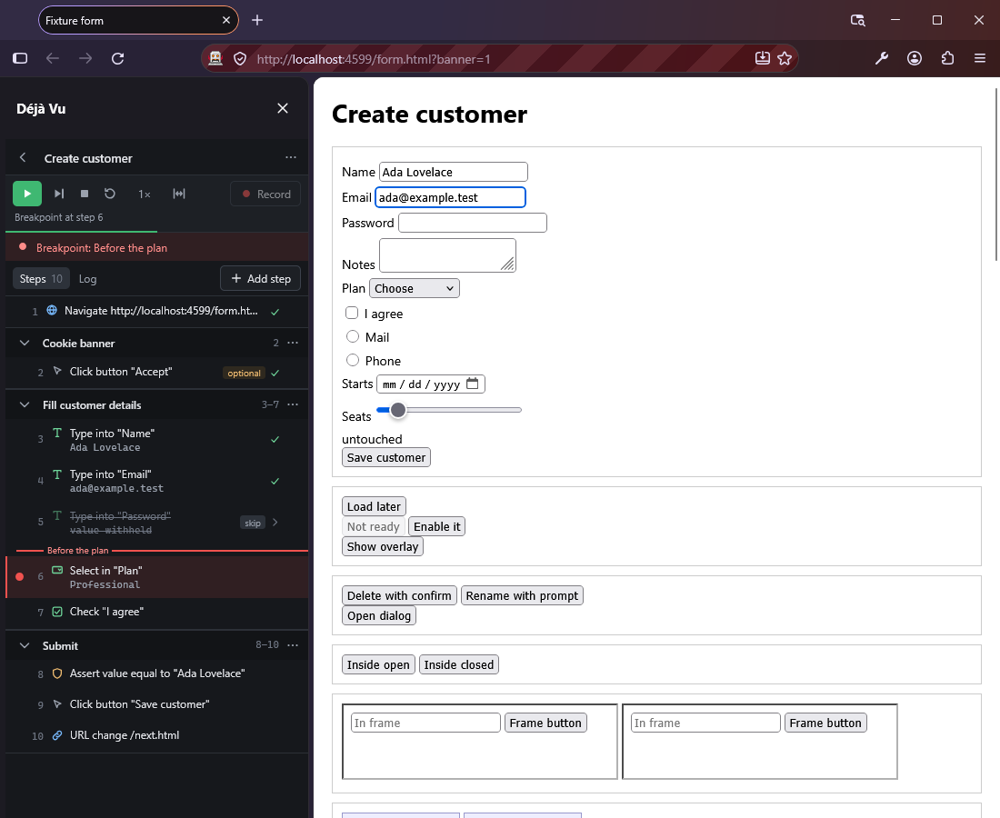

# Déjà Vu

Déjà Vu is a Firefox extension for web developers who keep re-entering the same long form to
reach the state they're working on. Record a workflow once, edit it, then replay all of it or
just the part you need, with debugger-style controls, from the Firefox sidebar.

- **Records logical steps.** Typing a name is one step, not twelve keystrokes.
- **Finds elements reliably.** Each element is stored with many selector strategies, and is
  checked against a fingerprint. Playback refuses to guess between ambiguous matches.
- **Debugs like code.** Breakpoints, single-stepping, step ranges, pause, retry, and live edits
  while paused.
- **Starts from a known state.** Setup steps set or delete cookies before each run.
- **Keeps your data local.** Nothing leaves your browser. Password values are never captured.



## Requirements

- Firefox 142 or newer. Tested on Firefox Developer Edition 160. 142 is the oldest version that
  supports everything in its manifest, but hasn't been tested.
- Node.js 22 or newer, to build

## Installation

First install the dependencies:

```bash
npm install
```

Then choose how to install the extension. A permanent installation keeps the extension and your
recordings when Firefox restarts. A temporary installation is quicker to set up, but is removed when
Firefox closes, and your recordings with it.

### Permanent installation

Requires Firefox Developer Edition or Nightly, which can install unsigned extensions.

1. Build and package the extension:

   ```bash
   npm run package
   ```

   The package is written to `artifacts/` as a `.zip`.
2. Open `about:config`, and set `xpinstall.signatures.required` to `false`.
3. Open `about:addons`, choose the gear menu, then **Install Add-on From File**.
4. Select the `.zip` from `artifacts/`.

To update the extension later, repeat steps 1, 3 and 4. Your recordings are kept.

### Temporary installation

Works in every Firefox edition, and suits trying the extension out or developing it.

1. Build the extension:

   ```bash
   npm run build
   ```

   The extension is written to `dist/`.
2. Open `about:debugging#/runtime/this-firefox`.
3. Choose **Load Temporary Add-on**.
4. Select `dist/manifest.json`.

To keep recordings made with a temporary installation, export them before you close Firefox.

## Getting started

Open the sidebar with the toolbar button or **Alt+Shift+D**.

### 1. Start a recording

1. Open the page you want to automate.
2. Press **Record** in the sidebar. The first time on a site, Firefox asks you to allow access.
3. Use the page as normal. Steps appear in the sidebar as you work, and a badge in the page
   reminds you that recording is on.
4. Press **Stop**.

While recording, **Add step** inserts checks as you go. For example, choose **Assertion**, then
**Pick element**, and click something in the page.

### 2. Save and edit recordings

Recordings save automatically, as does every edit. Open one from the **Recordings** tab.

| To do this | Do this |
| --- | --- |
| Inspect or edit a step | Click it. Name, comment, value, selectors and timing are all there. |
| Add or remove a breakpoint | Click the gutter, left of the step number. |
| Reorder | Drag a step, or use the arrows in its inspector. |
| Make a step optional or skip it | **When playing** in the inspector. |
| Change several steps at once | Ctrl-click or Shift-click to select them. |
| Group steps | Select them, then press the group button in the selection bar. |
| Check a selector | **Test** runs it against the current page. **Highlight** shows the element. |
| Add more steps | Open a step, then press **Record**. New steps go after it. |

### 3. Replay recordings

Press **Play**. The controls are:

| Control | Effect |
| --- | --- |
| Play / Pause | Starts the run, or pauses before the next step |
| Resume | Plays until the next breakpoint or the end |
| Play next step | Runs one step, then pauses |
| Stop | Ends the run immediately |
| Restart | Runs again from the first step |
| Speed | Changes the pause between steps, from 0.25× to Max |
| Range | Plays only steps *from* to *to*. Leave *from* empty to play the first X steps. |

A step's menu also has **Play from here**, **Play until here** and **Play only this step**.

If a required step fails, playback stops and shows what it tried and why. Fix the step while
it's stopped, then press **Retry**, or use **Skip step** to move on. The **Log** tab holds a timed
record of each run, and clicking an entry takes you to that step.

### 4. Import and export

- **One recording:** **Export** in the recording's menu. Bring it back with **Import from file** in the menu next to Record.
- **A collection:** open it and choose **Export collection**. **Import** on the Collections tab
  brings it back, with links between its recordings intact.

The export dialog can remove typed values, for sharing. Importing always creates new copies, so it
never overwrites anything.

## Step behaviour

Every step has one of three execution types:

- **Required**: playback stops if it fails.
- **Optional**: attempted, but playback continues if it can't be done. Use it for things that
  only sometimes appear, such as cookie banners. Optional steps give up sooner (2.5 seconds by default).
- **Skip**: stays in the recording, but doesn't run.

Beyond the steps you record, you can add:

- **Assertions**: element exists or is visible, text, input value, checked state, URL, title, or element count.
- **Waits**: for an element, text, a URL, a loading indicator to go away, or a fixed delay.
- **Conditions**: run a step only if an element exists, a URL matches, or a variable has a value.
- **Run another recording**: reuse a login sequence, for example.

### Waiting

Playback doesn't rely on fixed delays. Before acting, it waits until the element exists, is
visible, enabled and not covered, has stopped moving, and any loading indicators from Settings are
gone. Each wait has a timeout that you can set per step.

### Variables

Use `{{name}}` in values, URLs and assertions. Define variables from the recording's menu.

| Variable | Value |
| --- | --- |
| `{{$timestamp}}` | Milliseconds since 1970 |
| `{{$date}}` | Today's date, as `YYYY-MM-DD` |
| `{{$uuid}}` | A random UUID |
| `{{$random}}` | Six random digits |

Built-in variables stay the same throughout a run, so `user+{{$timestamp}}@example.com` gives a
fresh address every run, and a later assertion can check for the same address.

Variables marked **Secret** are asked for at each run and are never stored.

### Setup

Setup steps put the browser in a known state before the first step of every run. Open them with
**Setup** in the recording's menu.

| Setup step | Effect |
| --- | --- |
| Set cookie | Sets a cookie, optionally with path, domain, expiry, Secure, HttpOnly and SameSite |
| Delete cookie | Deletes every cookie with that name that the site receives, whatever its path |
| Delete all cookies | Deletes every cookie the site receives |

Each applies to the recording's starting URL unless you give it another **Site**. Names, values and
sites can use variables. Setup runs in order, in the cookie store of the tab being played in, and
before partial runs too, such as **Play from here**. **Restart** runs it again; **Retry** and
**Resume** don't. If a setup step fails, playback stops before the first step, and **Retry** and
**Skip step** work as they do for steps. Turn a setup step off with **Enabled** to keep it without
running it. When a recording is run by another one, its setup doesn't run.

## Privacy

- Recordings live in IndexedDB in your Firefox profile. There's no server, account or telemetry.
- Password fields, card fields and one-time codes are never stored. Their steps are kept without a value.
  Playback pauses there so that you can type, or you can use a secret variable.
- Turn off **Capture typed values** in Settings to withhold all typed text.
- Cookie values in setup steps are stored with the recording. For session tokens, use a secret
  variable, such as `{{token}}`, which is asked for at each run instead.
- Exclude parts of a page with a CSS selector in Settings, with **Pick element to exclude**,
  or by adding `data-dejavu-ignore` to your markup.
- Query parameters that look like credentials are replaced in recorded URLs.
- A banner in the sidebar and a badge in the page show when values are being captured.

### Permissions

| Permission | Why |
| --- | --- |
| `cookies` | Sets and deletes cookies for setup steps, only on sites you've allowed |
| `scripting` | Injects the recorder into a page, only during a session |
| `webNavigation` | Follows page loads and history changes during a session |
| `tabs` | Reads the current tab's URL, to know which site to ask access for |
| `storage` | Keeps a session's identity if Firefox suspends the background page |
| Host access, optional | Requested per site when you record or play. Revoke it in Settings. |

## Development

```bash
npm run dev
```

Rebuilds on change. Reload the extension in `about:debugging` to pick up background changes.

```bash
npm run typecheck
```

```bash
npm test
```

Unit tests, using jsdom and a fake IndexedDB.

```bash
npm run test:e2e
```

Builds the extension and tests it in real Firefox through WebDriver, against the site in
`tests/e2e/fixtures`. Set `FIREFOX_BINARY` if Firefox isn't in a standard location, and `HEADED=1`
to watch.

```bash
npm run lint:ext
```

Runs Mozilla's `web-ext lint`. Its `innerHTML` warnings come from inside React DOM.

## Publishing to addons.mozilla.org

Every upload needs a higher `version` in `public/manifest.json` than the last one. Commit, then:

```bash
npm run package
```

```bash
npm run package:source
```

The first builds the extension to upload. The second zips the committed source, because AMO
requires the source of generated code. Both go to `artifacts/`. When AMO asks whether the upload
contains generated code, answer yes, upload the source zip, and paste the contents of
[docs/AMO-REVIEW.md](docs/AMO-REVIEW.md) into the notes for reviewers.

Choose **Firefox** (desktop) only. Sidebars aren't available in Firefox for Android.

## Project layout

```
src/
  shared/            Data model, message protocol, utilities
  selector-engine/   Element to selectors, and selectors to exactly one element
  recording-engine/  DOM events to logical steps
  playback-engine/   State machine (engine.ts) and in-page execution (dom/)
  storage-engine/    IndexedDB, import/export, schema migrations
  background/        Sessions, injection, navigation tracking
  content-scripts/   Per-frame agent, page overlay, element picker
  sidebar-ui/        React interface
tests/
  unit/              Fast tests of each engine
  e2e/               Real Firefox tests, and the fixture site
```

## More documentation

- [Architecture](docs/ARCHITECTURE.md): how it fits together, and which Firefox constraints shaped it
- [Known limitations](docs/LIMITATIONS.md)
- [Export format](docs/EXPORT-FORMAT.md)
- [Notes for AMO reviewers](docs/AMO-REVIEW.md)

## License

[MIT](LICENSE)
